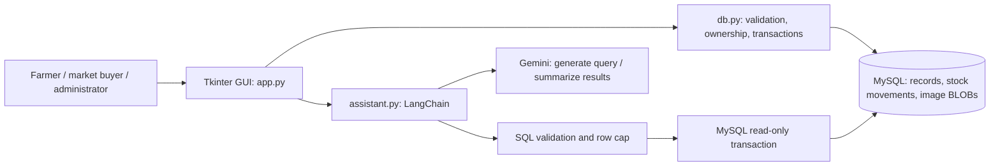

# Architecture, database, and transactions

This document describes the supplied implementation after relocation to `app/`. It is based on source inspection, not a new live database execution. See [requirements](PROJECT_REQUIREMENTS.md) for normative rules and [review findings](REPOSITORY_REVIEW.md) for limitations.

## Application boundaries



`app.py` owns windows, role tabs, tables, forms, image rendering, and assistant background work. `db.py` owns database connections, validation, operational transactions, and reference-data operations. `assistant.py` builds LangChain prompt/model/parser chains, validates generated queries, executes read-only queries, and produces summaries. `setup_database.py` loads the creation/population script. All `.env` and SQL lookup paths are relative to that application directory.

There is no HTTP API, service deployment, or new package architecture. Existing public Python function signatures, schema names, and runtime behavior are unchanged. Root batch files delegate to the original application batch files.

## Data model

The authoritative DDL is `app/schema.sql`: **15 tables and two views**. The tables below describe the implementation; they do not replace the required conceptual and relational diagrams.

| Table | Main key and relationships | Purpose / important constraints |
|---|---|---|
| `emirates` | PK `emirate_id` | Unique location name |
| `units` | PK `unit_id` | Unique code; active flag; no implemented conversion |
| `crops` | PK `crop_id`; FK default unit | Unique name, category, active flag |
| `markets` | PK `market_id`; FK emirate | Unique name, area, active flag |
| `farms` | PK `farm_id`; FK emirate | Unique name, area, active flag |
| `users` | PK `user_id`; nullable FK market | Unique email, role enum; market role requires market; other roles require null market |
| `farm_users` | Composite PK `(farm_id, user_id)`; both FKs | Many-to-many farmer assignments with assignment timestamp; farmer-role validation is in application logic |
| `crop_cycles` | PK `cycle_id`; FKs farm, crop, unit, creator | Expected quantity ≥ 0; expected date ≥ planting date; lifecycle enum; forecast only |
| `harvest_lots` | PK `lot_id`; FKs cycle, unit, creator | Quantity > 0; optional sell-by ≥ harvest date; active flag; crop/farm derived through cycle |
| `harvest_lot_images` | PK `image_id`; FKs lot, uploader | MEDIUMBLOB, name, MIME, timestamp; MIME check for JPEG/PNG |
| `market_requests` | PK `request_id`; FKs market, crop, unit, creator | Quantity > 0; needed-by date; six-status enum; notes |
| `request_status_history` | PK `history_id`; FKs request, actor | Old/new statuses, date/time, reason; status columns are VARCHAR, not status enums |
| `allocations` | PK `allocation_id`; FKs request, lot, unit, actor | Positive quantity; RESERVED/DELIVERED/RELEASED enum |
| `delivery_receipts` | PK `receipt_id`; unique FK allocation; FKs unit, confirmer | At most one receipt per allocation; received ≥ 0 and ≤ allocated; discrepancy = allocated − received |
| `stock_movements` | PK `movement_id`; FKs lot, unit, actor, optional allocation | Typed movements; nonzero quantity; only CORRECTION may be signed; date/time and reason |

An emirate has many farms and markets. A farm has many cycles; a cycle has many lots; a lot has zero or more images and movements. A request has zero or more allocations, each from one lot; a lot can supply multiple requests through allocations. An allocation has zero or one receipt. Users may be assigned multiple farms through the junction table; a buyer user belongs to one market, while a market can have multiple users.

For the conceptual ER deliverable, show these cardinalities and optionalities with justified business rules in Draw.io. For the separate relational schema, show every actual column/type, PK/FK, unique key, enum, and CHECK from SQL. Do not treat the application flowchart above as either assessed diagram.

## Inventory calculations

`v_lot_stock` aggregates movements per lot:

```text
on_hand = HARVEST_ADDED + CORRECTION − DELIVERED − LOSS − DONATED − DISPOSED
reserved = RESERVED − RESERVATION_RELEASED − DELIVERED
available = on_hand − reserved
```

The unit comes from the lot. Movement quantities are positive except signed corrections. Application actions ensure a lot's movement unit is consistent with the lot; cross-record unit equality is not enforced by a composite SQL constraint. Aggregated summaries group by crop and unit. A label such as “Box (5 kg)” does not activate any automatic conversion.

`stock_summary` reports **remaining expected harvest** as `max(expected_quantity − total quantity_harvested, 0)` for non-completed cycles. This forecast remains separate from stock. Harvest and date validation uses the current date; seed dates are relative to MySQL `CURDATE()`.

Example: harvest 100 kg → reserve 30 kg → receive 25 kg with a 5 kg discrepancy. On-hand/reserved/available progress from **100/0/100**, to **100/30/70**, to **70/0/70**. The final step records 25 delivered, releases the 5 missing from reservation, and records 5 as loss. A simple release without delivery restores availability without changing on-hand.

`v_request_status` exposes requested/allocated/received quantities by request. Allocated totals include all non-released allocations, including completed ones; received totals come from receipts. Quantities and status have distinct meanings.

## Transactions and ownership

The `transaction()` context manager commits on success, rolls back on exceptions, and closes the connection. Connections explicitly use READ COMMITTED; availability-changing operations retain lot locks, while request-changing operations acquire the parent request lock before allocation/lot locks. The [correctness follow-up](evidence/FIX_VALIDATION.md) records the stale-snapshot fix and regression results. User-entered SQL values use `%s` parameters. Dynamic identifier fragments are supplied by internal code/allowlists; SQL identifiers cannot be parameterized like values. There is no stored-procedure or trigger layer in the supplied schema.

| Operation | Atomic writes and checks |
|---|---|
| Add farm | Require farmer role; insert farm and self-assignment together |
| Add/complete cycle | Check assigned farm, active references and valid dates/quantity; lock cycle when completing |
| Record harvest | Validate optional image first; lock cycle; check ownership/status/dates; insert lot + harvest movement + optional BLOB; update growing cycle to HARVESTING |
| Loss/correction | Check role/ownership; lock lot; validate quantity/reason; prevent removal of reserved/unavailable stock; insert movement |
| Create/update request | Require buyer role; validate active references and future/current needed-by date; insert history on creation; updates lock/check own request and cannot reduce quantity below allocations |
| Allocate | Lock request then lot; require farmer ownership, open request, matching crop/unit, enough lot availability and request remainder; insert allocation + reservation + status/history update |
| Release allocation | Lock request, allocation and lot in that order; require owning farmer, RESERVED status and reason; insert release movement, mark RELEASED, refresh request/history |
| Cancel request | Lock own request; reject if delivered/cancelled or if any allocation has deliveries; release reservations, mark allocations RELEASED, record cancellation/history |
| Confirm delivery | Lock parent request, allocation and lot in that order; require own market and RESERVED status; validate actual quantity/reason; insert unique receipt, delivery and discrepancy movements; mark allocation DELIVERED; refresh request/history |
| Donate/dispose | Require farmer/lot ownership; lock lot; positive quantity ≤ available and recipient/reason; insert DONATED or DISPOSED movement |

Lot-row locks coordinate availability-changing operations. Locks alone are not fresh proof that every isolation/concurrency case is correct. The existing suite exercises one racing-allocation scenario; repeated delivery, release/cancel interactions, and rollback need broader verification.

Reference data and users are deactivated rather than deleted. Admin checks guard reference-data operations. The selector establishes a fictional application user, not an authenticated security boundary. Shared search/assistant reads are not restricted to “own records”; mutation ownership is enforced by the data layer.

## Delivery and request-status semantics

A partial delivery means recording less received than allocated in the allocation's single receipt. The application closes that allocation, releases the unreceived reservation, and treats its entire discrepancy as stock loss. It does not leave that same allocation open for a second receipt; a repeated confirmation is rejected.

`_refresh_request_status` derives OPEN/PARTIALLY_ALLOCATED/FULLY_ALLOCATED from non-released allocations. Once any allocation is delivered, it uses **DELIVERED** when no reserved allocations remain and allocated total reaches the requested total; otherwise it uses **PARTIALLY_DELIVERED**. It does **not** require actual received total to equal requested total. Seed request #6 illustrates this: 60 allocated, 52 received, status DELIVERED. The reviewer chose to retain this settlement policy: DELIVERED means allocations have been settled, while received quantities and discrepancies show shortages. The GUI now explains that distinction. This is a team policy, not a status definition stated by the instructor.

“Approved correction” is currently a farmer action with a required reason and label. There is no separate administrator approval workflow. Document that honestly if retained.

## Images

Farmers can upload JPG/JPEG/PNG files. Validation checks path, extension, nonempty size, maximum **5 MiB**, and Pillow image verification; image bytes and metadata go into MySQL. Buyers retrieve images through lot selection. The GUI handles no photo, unavailable/corrupt image, and database failure states. Sample BLOBs persist without external files; four external JPGs support the upload demonstration. Restart persistence must be tested without running setup between sessions.

## LangChain assistant

1. GUI sends a nonempty question (maximum 500 characters) to a background worker.
2. An allowlisted, non-BLOB schema description is supplied to a LangChain prompt → Gemini → string-parser chain.
3. The model returns a SELECT/CTE query, `CLARIFY`, or `NOT_ANSWERABLE`.
4. Regex-based validation rejects multiple statements/comments, blocked words, and detected unapproved table names; accepted SQL is wrapped with a 200-row limit.
5. SQL runs in `START TRANSACTION READ ONLY`; the connection is rolled back and closed.
6. A second chain summarizes up to the first 50 returned rows. GUI shows the answer, SQL, and supporting records.

Ambiguous/unsupported requests, empty results, invalid questions, database errors, and service failures have response paths. No-key behavior is surfaced in the GUI. Model access and live answers have not been verified locally.

The validator is not a full SQL parser or a proven security sandbox. Read-only transactions restrict writes but do not establish row ownership, semantic correctness, or complete SQL grammar/function safety. Summaries can differ from the full 200-row result because only 50 rows are passed to the summarizer. Verify answer correctness against SQL and do not claim model-generated summaries are independently validated.

## Loss & Surplus

The SQL-backed flag query starts with active lots having available quantity > 0. Default thresholds are **near expiry ≤ 3 days** and **unallocated age ≥ 7 days**. Accepted input ranges are integer near-expiry days 0–60 and surplus days 0–365.

| Priority | Flag | Implemented condition |
|---:|---|---|
| 1 | EXPIRED | Sell-by exists and is before today |
| 2 | NEAR EXPIRY | Sell-by exists and days remaining ≤ near-expiry threshold, excluding higher priority |
| 3 | UNALLOCATED SURPLUS | No non-RELEASED allocation and harvest age ≥ surplus threshold, excluding higher priorities |

SQL selects candidate records; Python assigns flags/priorities and sorts by priority, fewest days left (null treated as 9999), then most available stock. Because RELEASED allocations are excluded, “unallocated” includes lots whose prior allocations were all released; the historical phrase “never allocated” is imprecise. Thresholds are adjustable per query, not persisted settings.

Farmers view assigned farms and perform donation/disposal. Admins see all flags/history without disposition controls. Both actions reduce on-hand and available equally, leave reserved quantity untouched, and persist actor/date/reason in stock movements. The implementation currently allows donation of any flagged lot including expired lots; no food-suitability rule is defined in the proposal or code. This is an educational stock action, not a real-world food-distribution policy.
